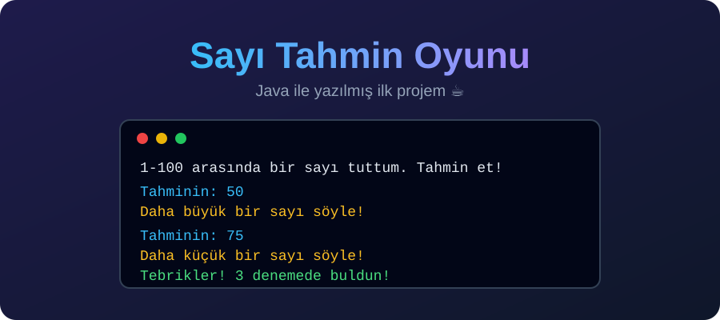

<p align="center">
  
</p>

# 🎯 Sayı Tahmin Oyunu

Java ile yazdığım ilk proje. Bilgisayar 1-100 arasında bir sayı tutuyor, sen de ipuçlarıyla sayıyı bulmaya çalışıyorsun.

## 🎮 Nasıl Oynanır?

1. Programı çalıştır.
2. Klavyeden bir tahmin gir.
3. Program "daha büyük" veya "daha küçük" diye ipucu verir.
4. Doğru sayıyı bulunca kaç denemede bulduğun yazılır.

## ▶️ Çalıştırma

```bash
javac Main.java
java Main
```

## 📚 Bu Projede Kullanılanlar

- `Scanner` ile klavyeden veri okuma
- `Random` ile rastgele sayı üretme
- `while` döngüsü
- `if / else if / else` yapısı

## 🚀 Gelecek Planları

- [ ] Deneme hakkı sınırı
- [ ] "Tekrar oynamak ister misin?" seçeneği
- [ ] Hatalı giriş kontrolü

## 👤 Geliştirici

Java öğrenme yolculuğumun ilk adımı. ☕
